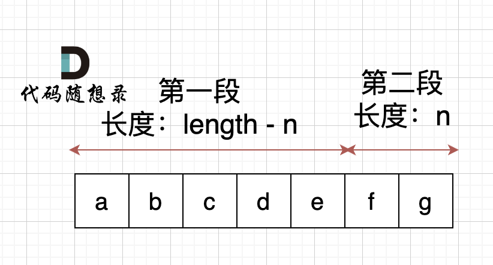
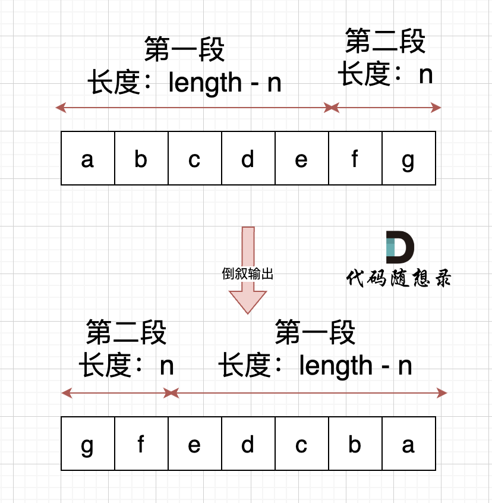
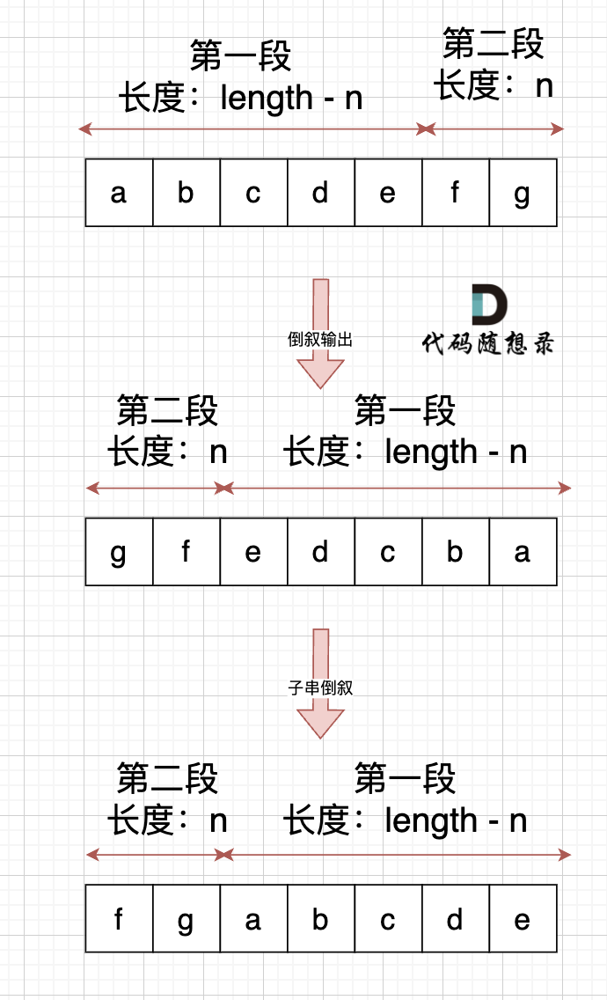
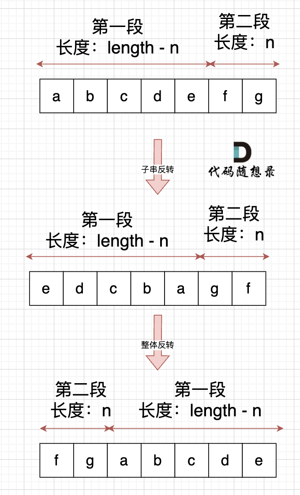

[卡码网题目链接(opens new window)](https://kamacoder.com/problempage.php?pid=1065)

字符串的右旋转操作是把字符串尾部的若干个字符转移到字符串的前面。给定一个字符串 s 和一个正整数 k，请编写一个函数，将字符串中的后面 k 个字符移到字符串的前面，实现字符串的右旋转操作。

例如，对于输入字符串 "abcdefg" 和整数 2，函数应该将其转换为 "fgabcde"。

输入：输入共包含两行，第一行为一个正整数 k，代表右旋转的位数。第二行为字符串 s，代表需要旋转的字符串。

输出：输出共一行，为进行了右旋转操作后的字符串。

样例输入：

```text
2
abcdefg 
```

样例输出：

```text
fgabcde
```

数据范围：1 <= k < 10000, 1 <= s.length < 10000;

## [#](https://programmercarl.com/algo/string/kamacoder-0055-right-rotate-string.html#%E6%80%9D%E8%B7%AF)思路

为了让本题更有意义，提升一下本题难度： **不能申请额外空间，只能在本串上操作** 。 （Java不能在字符串上修改，所以使用java一定要开辟新空间）

不能使用额外空间的话，模拟在本串操作要实现右旋转字符串的功能还是有点困难的。

那么我们可以想一下上一题目[字符串：花式反转还不够！](https://programmercarl.com/algo/string/0151-reverse-words-in-a-string.html)中讲过，使用整体反转+局部反转就可以实现反转单词顺序的目的。

本题中，我们需要将字符串右移n位，字符串相当于分成了两个部分，如果n为2，符串相当于分成了两个部分，如图： （length为字符串长度）



右移n位， 就是将第二段放在前面，第一段放在后面，先不考虑里面字符的顺序，是不是整体倒叙不就行了。如图：



此时第一段和第二段的顺序是我们想要的，但里面的字符位置被我们倒叙，那么此时我们在把 第一段和第二段里面的字符再倒叙一把，这样字符顺序不就正确了。 如果：




其实，思路就是 通过 整体倒叙，把两段子串顺序颠倒，两个段子串里的的字符在倒叙一把， **负负得正** ，这样就不影响子串里面字符的顺序了。

整体代码如下：

```C
// 版本一
#include<iostream>
#include<algorithm>
using namespace std;
int main() {
    int n;
    string s;
    cin >> n;
    cin >> s;
    int len = s.size(); //获取长度

    reverse(s.begin(), s.end()); // 整体反转
    reverse(s.begin(), s.begin() + n); // 先反转前一段，长度n
    reverse(s.begin() + n, s.end()); // 再反转后一段

    cout << s << endl;

}
```


那么整体反正的操作放在下面，先局部反转行不行？

可以的，不过，要记得 控制好 局部反转的长度，如果先局部反转，那么先反转的子串长度就是 len - n，如图：




代码如下：

```C
// 版本二
#include<iostream></iostream>
#include<algorithm></algorithm>
using namespace std;
int main() {
    int n;
    string s;
    cin >> n;
    cin >> s;
    int len = s.size(); //获取长度
    reverse(s.begin(), s.begin() + len - n); // 先反转前一段，长度len-n ，注意这里是和版本一的区别
    reverse(s.begin() + len - n, s.end()); // 再反转后一段
    reverse(s.begin(), s.end()); // 整体反转
    cout << s << endl;

}
```

# 其他语言

```Python
k = int(input())
s = input()

# 右旋超过字符串长度时，取余得到实际需要移动的位数
k %= len(s)

# 后 k 个字符放前面，其余字符放后面
s = s[-k:] + s[:-k]

print(s)
```

```Python
def reverse(chars, left, right):
    # 反转闭区间 [left, right] 内的字符
    while left < right:
        chars[left], chars[right] = chars[right], chars[left]
        left += 1
        right -= 1


k = int(input())
chars = list(input())
n = len(chars)
k %= n

reverse(chars, 0, n - 1)  # 整体反转
reverse(chars, 0, k - 1)  # 反转前 k 个字符
reverse(chars, k, n - 1)  # 反转剩余字符

print("".join(chars))
```
